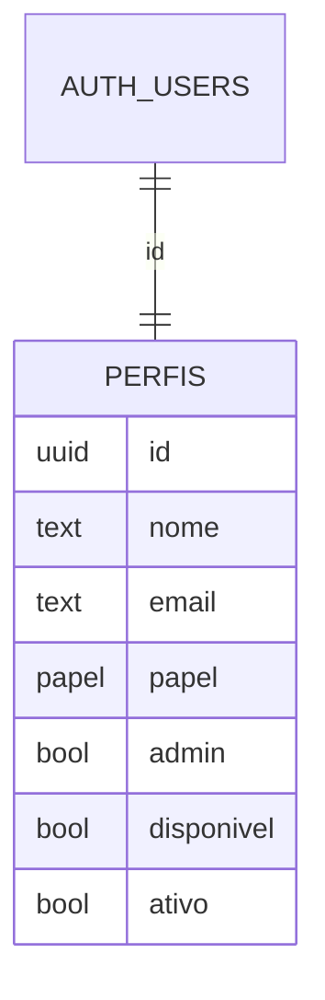

# REASONS — REQ-001 — Acesso e papéis
**Status:** APROVADO — por delegação: semente APROVADO — Natanael, 2026-10-25, segue a cadeia
**Requisito:** `requirements/REQ-001-acesso-e-papeis.md`
**Análise:** `spdd/analysis/REQ-001-acesso-e-papeis.md`

## R · Requirements

Cada pessoa do Club entra com usuário próprio e vê só o que o papel dela permite; a Fernanda cadastra usuários. Fora: SSO, permissão por campo.

## E · Entities

- `papel`: `primeira_pessoa`, `gerente`, `direcao`, `juridico`, `financeiro`, `operacoes`.
- `disponivel` serve ao revezamento de Gerentes (REQ-007).

## A · Approach

Auth do Supabase com e-mail e senha; perfil e papel numa tabela própria, legível por qualquer usuário autenticado e alterável só por `rpc` de administrador. Funções `meu_papel()` e `sou_admin()` (`security definer`, `stable`) servem às RLS de todos os REQs. Criação de usuário por função de borda com a chave de serviço. Na tela, `permissoes.ts` diz o que cada papel faz e o menu e os botões consultam só ele.

## S · Structure

- `supabase/migrations/20261025000100_req-001-acesso.sql` — tipo, tabela, funções, RLS, `rpc` `definir_papel`, `definir_disponibilidade`.
- `supabase/functions/usuarios/index.ts` — cria usuário (admin).
- `supabase/seed.sql` — usuários de exemplo.
- `src/dados/supabase.ts`, `src/dados/tipos.ts`, `src/dados/api.ts`.
- `src/lib/permissoes.ts` + `src/lib/permissoes.test.ts`.
- `src/sessao.tsx` — contexto da sessão e do perfil.
- `src/estilo.css`, `src/main.tsx`, `src/App.tsx`.
- `src/componentes/Casca.tsx`, `src/componentes/EmBreve.tsx`.
- `src/telas/acesso/Entrar.tsx`, `src/telas/acesso/RedefinirSenha.tsx`, `src/telas/config/Usuarios.tsx`.

## O · Operations

- **OP-0101 Banco.** Migration com o tipo `papel`, `perfis` (PK = `auth.users.id`, `email` único), `meu_papel()`, `sou_admin()`, RLS (`select` para autenticados; nenhum `insert/update/delete` direto), `definir_papel(usuario, papel, admin)` e `definir_disponibilidade(usuario, disponivel)` só para admin (a disponibilidade também pelo próprio usuário). Verifica: `supabase migration up` sem erro; `select` anônimo em `perfis` retorna vazio.
- **OP-0102 Seed.** Sete usuários em `auth.users`/`auth.identities` com senha comum de exemplo e perfis; Fernanda `admin = true`. Verifica: login de cada um pela API.
- **OP-0103 Função de borda `usuarios`.** `POST {email, nome, papel, senha}`; valida o token de quem chama, exige `sou_admin`, cria no Auth com e-mail confirmado e insere o perfil. Erros: 401 sem token, 403 não admin, 409 e-mail existente. Verifica: chamada com token da Fernanda cria; com token da Isabela recebe 403.
- **OP-0104 Dados e sessão.** Cliente com `VITE_SUPABASE_URL`/`VITE_SUPABASE_ANON_KEY`; `api.ts`: `entrar`, `sair`, `pedirNovaSenha`, `definirNovaSenha`, `perfilAtual`, `listarUsuarios`, `criarUsuario`, `alterarPapel`, `alterarDisponibilidade`. `sessao.tsx` expõe `{carregando, perfil}` e reage a mudanças do Auth. Verifica: typecheck.
- **OP-0105 Permissões.** `pode(perfil, acao)` com as ações do sistema todo (`ver_crm`, `gerir_usuarios`, `editar_empresa`, `triar`, `conduzir`, `decidir_direcao`, `juridico`, `financeiro`, `operacoes`, `configurar`). Matriz da semente (regras 2 a 5). Verifica: teste — gerente não `decidir_direcao`, direção sim, primeira pessoa `triar`.
- **OP-0106 Casca e rotas.** Rotas: `/entrar`, `/redefinir-senha`, e dentro da casca `/funil`, `/empresas`, `/parcerias`, `/calendario`, `/renovacoes`, `/painel`, `/config/usuarios`. Rota protegida sem sessão leva a `/entrar`. Menu agrupado; item "Usuários" só com `gerir_usuarios`. Áreas ainda sem REQ mostram `EmBreve`. Estados: carregando sessão mostra "Carregando…".
- **OP-0107 Entrar e redefinir senha.** Formulário e-mail/senha; erro do Auth mostra S-0102. "Esqueci a senha" envia o link; `/redefinir-senha` define a nova.
- **OP-0108 Usuários.** Lista (nome, e-mail, papel, admin, disponível); formulário de novo usuário; troca de papel em linha. Vazio: "Nenhum usuário cadastrado."

## N · Norms

- N-0101 Regras do `CLAUDE.md` (dados só por `api.ts`, permissão só por `permissoes.ts`).
- N-0102 Rótulos dos papéis: "1ª pessoa", "Gerente", "Direção", "Jurídico", "Financeiro", "Operações".

## S · Safeguards

- S-0101 A chave de serviço nunca vai para o front nem para o `.env.local`.
- S-0102 Login errado: "E-mail ou senha incorretos."
- S-0103 Nenhuma tabela nova sem RLS ligada.
- S-0104 Usuário não admin que abre `/config/usuarios` vê "Você não tem acesso a esta área."

## Matriz de rastreabilidade

| Critério | Operations | Verificação |
|---|---|---|
| 1 | OP-0105 | teste de permissão |
| 2 | OP-0105 | teste de permissão (tela no REQ-009) |
| 3 | OP-0106 | navegador: `/funil` sem sessão abre `/entrar` |
| 4 | — | REQ-004 (linha do tempo) |
