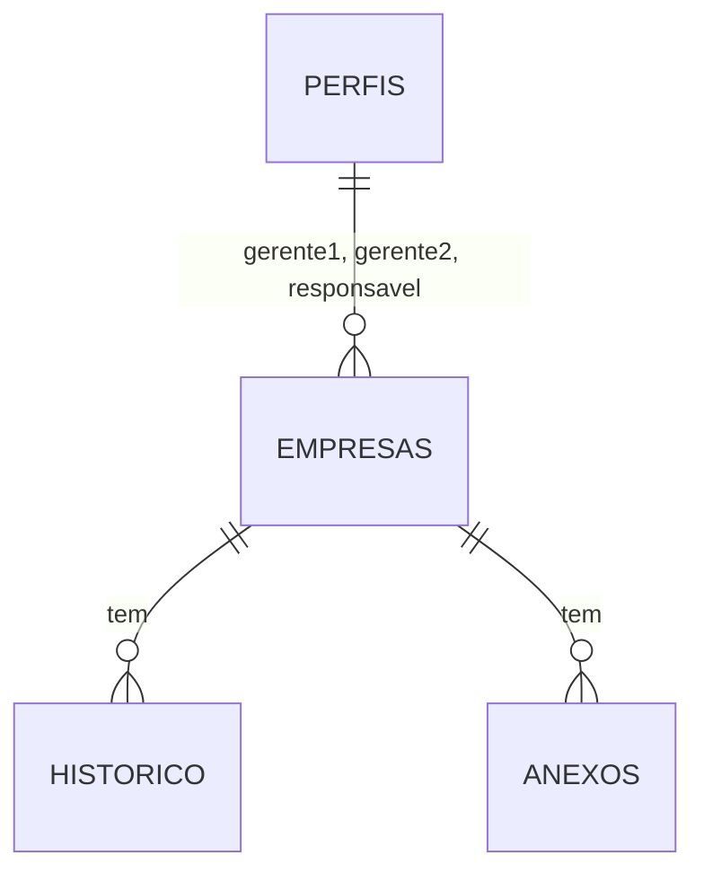

# REASONS — REQ-004 — Funil de parcerias
**Status:** APROVADO — por delegação: semente APROVADO — Natanael, 2026-10-25, segue a cadeia
**Requisito:** `requirements/REQ-004-funil-de-parcerias.md`
**Análise:** `spdd/analysis/REQ-004-funil-de-parcerias.md`

## R · Requirements

Ver onde cada empresa está, quem cuida dela e por que saiu, mudando de etapa só pelas regras. Fora: etapas configuráveis.

## E · Entities

- `etapa`: `recebida`, `triagem1`, `triagem2`, `reuniao`, `proposta`, `direcao`, `contrato`, `ativa`, `renovacao`, `encerrada`, `espera`, `recusada`.
- `origem`: `site`, `indicacao_membro`, `indicacao_funcionario`, `indicacao_direcao`, `whatsapp`, `email`, `contato_direto`.
- `empresas`: identificação (CNPJ só dígitos, único), blocos 1 a 3 do formulário (cap. 5), `origem`, `indicado_por`, `consentimento_em`, `etapa`, `etapa_desde`, `motivo_saida`, `retomar_em`, `gerente1_id`, `gerente2_id`, `responsavel_id`, `porte`, `padrao_final` (preenchidos no REQ-006), `exemplo`, `criado_em`, `criado_por`.
- `historico`: `tipo` (`etapa`, `nota`, `edicao`, `mensagem`, `sistema`), `de_etapa`, `para_etapa`, `texto`, `autor_id`, `em`.
- `anexos`: `tipo` (`portfolio`, `apresentacao`, `logotipo`, `aceite`, `minuta`, `contrato`, `entrega`, `outro`), `caminho` no bucket, `nome`, `tamanho`, `autor_id`.

## A · Approach

`mover_etapa` é a única porta de mudança: valida saídas, bloqueia `ativa` e `direcao`, chama `requisitos_etapa(empresa, para)` (que devolve a mensagem do que falta ou nulo; os REQs seguintes recriam essa função acrescentando regras) e grava o histórico. Campos livres por `update` com grant por coluna. Gatilho de edição registra quais campos mudaram. Front: regras de etapa puras em `src/regras/etapas.ts`; Funil com arrastar (HTML5) e a mesma troca pela ficha.

## S · Structure

- `supabase/migrations/20261025000400_req-004-funil.sql`
- `supabase/seed.sql` — empresas de exemplo em várias etapas.
- `src/regras/etapas.ts` + `etapas.test.ts`
- `src/dados/tipos.ts`, `src/dados/api.ts` — tipos e funções de empresa, histórico, anexos.
- `src/componentes/TrocaEtapa.tsx`, `src/componentes/Formato.tsx` (CNPJ, datas, padrão).
- `src/telas/funil/Funil.tsx`, `src/telas/empresas/Empresas.tsx`, `src/telas/empresa/Ficha.tsx`.
- `src/App.tsx` — rotas `/funil`, `/empresas`, `/empresas/:id`.

## O · Operations

- **OP-0401 Banco.** Tipos, tabelas, índices (`etapa`, `cnpj`, `criado_em`), RLS: leitura para 1ª pessoa, Gerente e Direção em tudo; Jurídico em `contrato` em diante; Financeiro e Operações em `proposta` em diante. `insert` por 1ª pessoa e Gerente. `update` por coluna (dados do formulário) para 1ª pessoa e Gerente. `historico`: leitura igual à da empresa; `insert` de nota por quem lê. Bucket `anexos` privado, caminho `empresa/<id>/<arquivo>`, mesma regra de leitura.
- **OP-0402 Regras no banco.** `requisitos_etapa(empresa, para)` inicial devolve nulo; `mover_etapa(empresa, para, motivo, retomar)`: S-0401 a S-0404; atualiza `etapa`, `etapa_desde`, `motivo_saida`, `retomar_em`; grava histórico. Gatilho `after update` registra campos alterados (exceto colunas de etapa). Verifica: SQL — mover para `recusada` sem motivo falha; para `ativa` falha.
- **OP-0403 Seed.** Oito empresas de exemplo (marcadas) espalhadas nas etapas, com padrão e porte, para os filtros.
- **OP-0404 Regras puras.** `etapas` (ordem, rótulo, se é saída), `exigeMotivo`, `exigeRetomar`, `podeArrastarPara`. Verifica: testes.
- **OP-0405 Dados.** `api.ts`: `listarEmpresas(filtros)`, `obterEmpresa(id)`, `atualizarEmpresa(id, campos)`, `moverEtapa`, `listarHistorico`, `adicionarNota`, `listarAnexos`, `enviarAnexo`, `urlAnexo`. Verifica: typecheck.
- **OP-0406 Funil.** Colunas na ordem, contagem, cartão (marca, segmento, padrão, Gerente, dias na etapa), filtros (padrão, porte, segmento, Gerente, origem). Arrastar chama `TrocaEtapa` quando a etapa pede motivo; destino `ativa` mostra S-0403 sem chamar o banco. Estados: carregando, erro, vazio ("Nenhuma empresa no funil ainda.").
- **OP-0407 Empresas.** Tabela ordenada por chegada (mais nova em cima), busca por marca, razão social ou CNPJ, clique abre a ficha.
- **OP-0408 Ficha.** Cabeçalho (marca, CNPJ formatado, etapa, padrão, responsável), abas Resumo (dados do formulário por bloco, editáveis por quem pode `editar_empresa`), Anexos (lista, enviar), Linha do tempo (itens + nova nota), troca de etapa por seleção.

## N · Norms

- N-0401 Regras do `CLAUDE.md`. Rótulos das etapas exatamente como na semente.
- N-0402 Datas na linha do tempo: `dd/mm/aaaa hh:mm`.

## S · Safeguards

- S-0401 Em espera ou Recusada sem motivo: "Informe o motivo da saída."
- S-0402 Em espera sem data: "Informe a data para retomar."
- S-0403 Para Ativa: "A parceria só fica ativa ao registrar a assinatura do contrato."
- S-0404 Para Com a Direção: "O caso vai para a Direção pela porta da Direção, na proposta."
- S-0405 Saída depois de Ativa: "Parceria ativa não sai do funil por aqui: use a renovação ou o encerramento."
- S-0406 Nenhum dado de membro, nenhum CPF nestas telas.

## Matriz de rastreabilidade

| Critério | Operations | Verificação |
|---|---|---|
| 1 | OP-0403, OP-0406, OP-0407 | navegador: empresa nova em Recebida e no topo |
| 2 | OP-0402, OP-0406 | SQL e navegador |
| 3 | OP-0402, OP-0406 | navegador: arrastar para Ativa mostra S-0403 |
| 4 | OP-0406 | navegador: filtro Prata |
| 5 | OP-0402, OP-0408 | navegador: linha do tempo |
